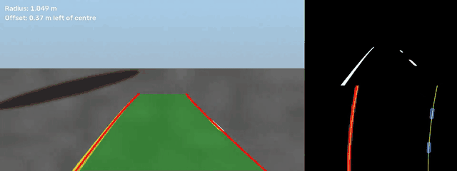
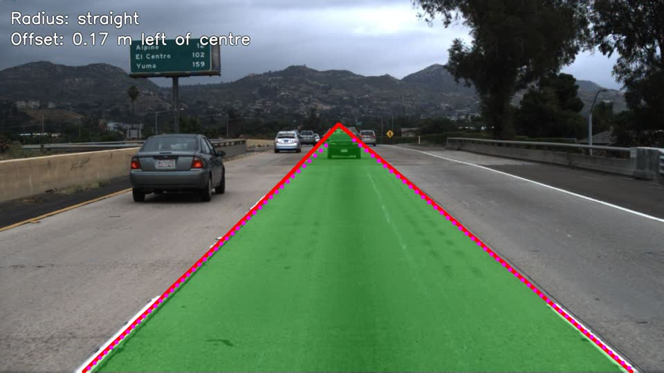

# lanedet: lane detection for automated driving

A Python/OpenCV library that finds the ego-lane lines in road video, estimates lane curvature and the
vehicle's offset from the lane centre, smooths the result over time, and draws it on the frame. It
comes with a TuSimple-style evaluation, a Hough-line baseline for comparison, unit tests on synthetic
roads, a CLI, and a step-by-step notebook.



*Synthetic drive: overlay on the left; binary mask and bird's-eye sliding-window search on the right.
Full clip: [docs/demo.mp4](docs/demo.mp4) (regenerate with `scripts/make_demo_video.py`).*

## How it works

```
frame → (undistort) → colour + gradient mask → ROI → bird's-eye warp → histogram + sliding windows
      → 2nd-order polyfit → curvature / offset → tracker (sanity checks, smoothing, fallback) → overlay
```

1. **Mask**: HLS saturation (yellow paint), HLS lightness (white paint) and the Sobel x-gradient of
   lightness, OR-ed and cleaned with a morphological close, then clipped to a trapezoidal ROI.
2. **Bird's-eye view**: a perspective transform maps the road trapezoid to a rectangle, so the lane
   lines become near-vertical and parallel.
3. **Search**: a column histogram finds where each line starts; sliding windows follow it upwards.
   On later frames the search uses a band around the previous fit instead.
4. **Fit and geometry**: `x = Ay² + By + C` per line. Converted to metres, this gives the radius
   `R = (1 + (2Ay + B)²)^1.5 / |2A|` and the offset of the camera from the lane centre.
5. **Tracking**: a new fit is accepted only if the lane width is plausible, the lines are parallel,
   and neither line jumped. Otherwise the average of recent good fits is shown. After 5 bad frames in
   a row, the tracker resets and searches from scratch.

Design details, parameter choices and failure modes: [docs/design.md](docs/design.md).

## Install

Python 3.10+.

```bash
git clone https://github.com/Ishaan-Giri/lane-detection.git && cd lane-detection
python -m venv .venv && source .venv/bin/activate
pip install -e ".[dev]"
```

## Quick start

```bash
# Annotate a video, a folder of images, or one image (add --debug for the mask/bird's-eye panels)
lanedet run --input drive.mp4 --output out/drive_annotated.mp4 --debug \
            --json out/frames.json          # per-frame coefficients, curvature (m), offset (m)

# No footage at hand? Make a synthetic TuSimple-format dataset and run on it
lanedet synth --output data/synthetic --clips 10
lanedet run --input data/synthetic/clips/curve_001 --output out/curve_001

# Evaluate all variants (Hough, sliding window, + smoothing) on a TuSimple-format dataset
lanedet eval --dataset data/synthetic --output results/synthetic.json
```

From Python:

```python
import cv2
from lanedet import LanePipeline, load_config
from lanedet.overlay import draw_lanes

pipe = LanePipeline(load_config("configs/default.yaml"))
frame = cv2.imread("road.jpg")
result = pipe.process(frame)
print(result.curvature_m, result.offset_m, result.left.coeffs)
cv2.imwrite("road_lanes.jpg", draw_lanes(frame, result))
```

Every threshold, the ROI, the perspective points, window sizes and tracker limits are in
[configs/default.yaml](configs/default.yaml). The perspective points are camera-specific: `default.yaml` is a generic
starting point, and [configs/tusimple.yaml](configs/tusimple.yaml) is fitted to TuSimple's camera. See
[docs/design.md, "Setting the perspective points"](docs/design.md#setting-the-perspective-points).

## Evaluation

Metric (TuSimple-style): at each labelled row, a point is correct if it is within 20 px of the
ground truth; a lane matches if ≥ 85% of its points are correct.
Accuracy = correct GT points / GT points; FP = unmatched predictions / predictions;
FN = unmatched GT lanes / GT lanes. Only the two ego-lane lines are scored by default (`--all-lanes`
scores every line). FPS counts detector time on one CPU thread, excluding disk I/O.

**TuSimple test set** (all 2,782 labelled frames; config tuned on training data only, see
[docs/results.md](docs/results.md); run on Kaggle, so FPS is from a shared Xeon VM, one thread):

| Variant | Accuracy | FP | FN | FPS |
|---|---|---|---|---|
| Hough-line baseline | 76.5% | 0.444 | 0.449 | 108.7 |
| Sliding-window polynomial (main) | 82.6% | 0.261 | 0.297 | 23.3 |
| + temporal smoothing | 82.8% | 0.255 | 0.296 | 24.3 |

The untuned default config scores 35.6%, so the camera points matter a lot. Main failure cases are
faint markings, pavement seams and texture, construction zones, and shadows of nearby vehicles
(examples in results.md). CNN methods report above 95% on TuSimple with the standard all-lanes
metric. This is a classical baseline, not a competitive detector.



**Synthetic sanity check** (50 clips; 1280x720; AMD Ryzen 5 5600H, one thread). These numbers
confirm the code is correct end to end, not that it works on real roads:

| Variant | Accuracy | FP | FN | FPS |
|---|---|---|---|---|
| Hough-line baseline | 98.2% | 0.056 | 0.056 | 406.0 |
| Sliding-window polynomial (main) | 100.0% | 0.000 | 0.000 | 55.3 |
| + temporal smoothing | 99.9% | 0.100 | 0.000 | 58.1 |

Reproduce: `python scripts/evaluate.py --synthetic --clips 50 --output results/synthetic.json`.

Tests: 93, at 97% line coverage of `src/lanedet`.

### Running on TuSimple

TuSimple (1280x720 US-highway clips, the 20th frame of each clip labelled) is about 20 GB. Its
original GitHub links ([TuSimple/tusimple-benchmark](https://github.com/TuSimple/tusimple-benchmark))
are often dead. At the time of writing, a mirror including `test_label.json` is on Hugging Face
([dhbloo/TuSimple](https://huggingface.co/datasets/dhbloo/TuSimple)), and copies exist on Kaggle.
Check the licence of whichever copy you use. The expected layout:

```
data/tusimple/
├── train_set/  clips/…  label_data_0313.json  label_data_0531.json  label_data_0601.json
└── test_set/   clips/…  test_label.json
```

```bash
# tune on training clips (development set) ...
lanedet eval -d data/tusimple/train_set --labels data/tusimple/train_set/label_data_0313.json --limit 300
# ... then report once on the test set
python scripts/evaluate.py --dataset data/tusimple/test_set \
    --labels data/tusimple/test_label.json --save-worst 5 --output results/tusimple.json
```

**Without downloading (Kaggle).** [kaggle/tusimple_eval.py](kaggle/tusimple_eval.py) does the
whole run (calibrate and tune on training clips, then score the test set once) inside a Kaggle
notebook with the [manideep1108/tusimple](https://www.kaggle.com/datasets/manideep1108/tusimple)
dataset attached. It needs the Kaggle CLI and an API token in `~/.kaggle/kaggle.json`:

```bash
pip install kaggle
python scripts/kaggle_push.py      # bundles lanedet into one script, pushes a private notebook
kaggle kernels status <user>/lanedet-tusimple-eval
kaggle kernels output <user>/lanedet-tusimple-eval -p results/kaggle   # tusimple.json/.yaml, failures/
```

The tuned config it writes is saved as [configs/tusimple.yaml](configs/tusimple.yaml).

## Project layout

```
src/lanedet/      config, camera, preprocess, perspective, lanefit, tracker, pipeline, hough,
                  overlay, metrics, evaluation, io, synthetic, cli
configs/          default.yaml
tests/            unit + end-to-end tests on synthetic roads (no dataset needed)
scripts/          evaluate.py, make_demo_video.py, kaggle_push.py
kaggle/           tusimple_eval.py: tune on TuSimple train, score test (runs as a Kaggle notebook)
notebooks/        demo.ipynb: every stage shown as an image
docs/             design.md, results.md, demo media
```

## Development

```bash
ruff check . && ruff format --check .
pytest --cov=lanedet
```

CI (GitHub Actions) runs lint and tests on Python 3.10–3.12 for every push.

## Limitations

- Flat-road assumption: hills and camera pitch break the bird's-eye geometry and the metre scale.
- Fixed colour and gradient thresholds: night, glare, rain and heavy shadow degrade the mask.
- Only the ego lane; no multi-lane detection or lane-change prediction.
- Curvature and offset depend on `lane_width_m`, `view_length_m` and a centred camera, which are
  assumptions, not calibrated values.
- Synthetic test roads are much easier than real ones. On TuSimple, about 30% of ego lanes are
  still missed (FN 0.30).

Optional next step (not built): a small CNN mask extractor. `LanePipeline(mask_extractor=...)`
accepts any `frame -> mask` callable, so it can replace the thresholding stage without changing the rest.

## Licence

MIT. See [LICENSE](LICENSE).
