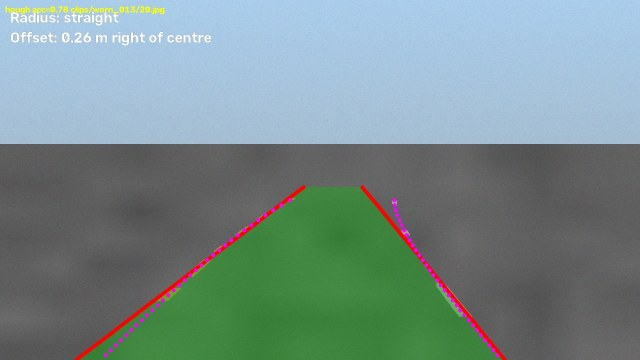
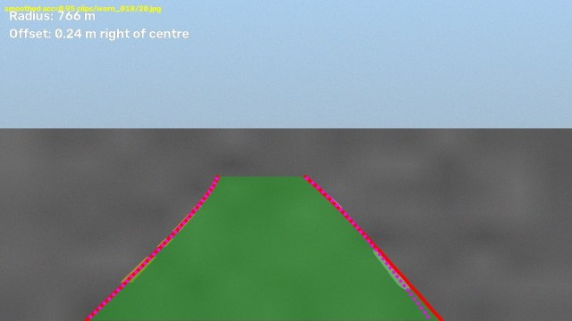
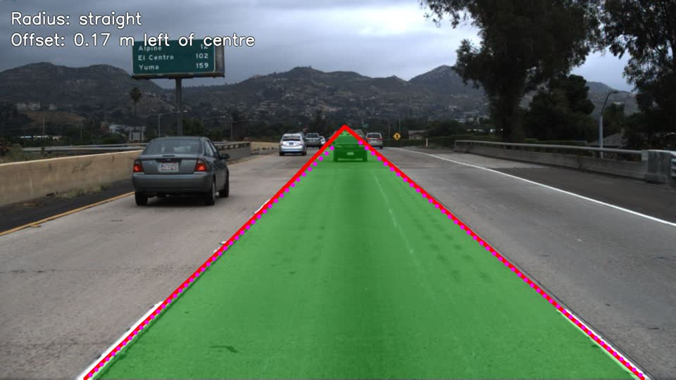
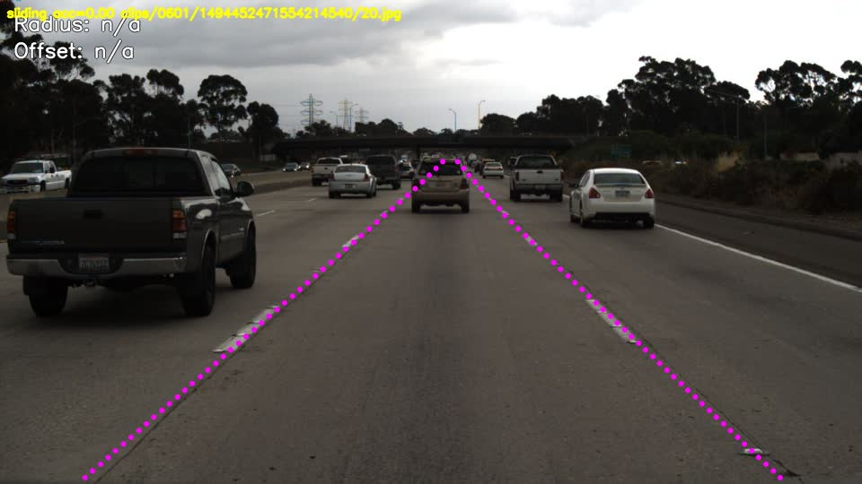
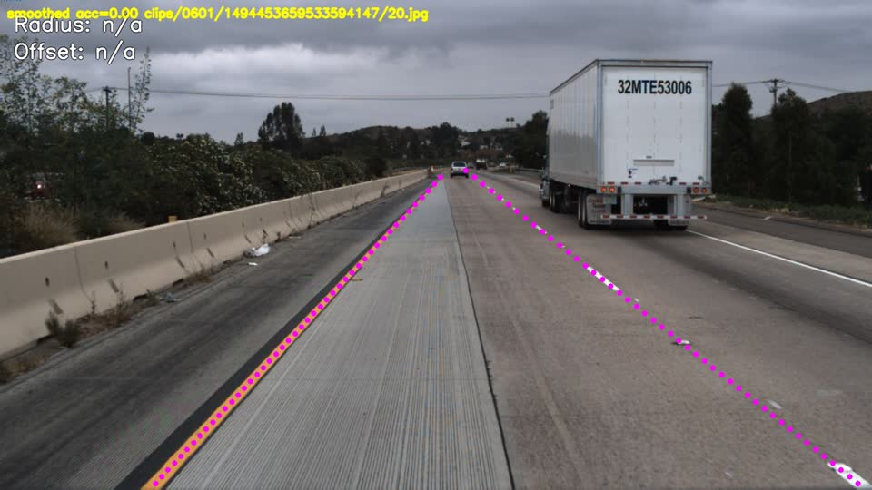
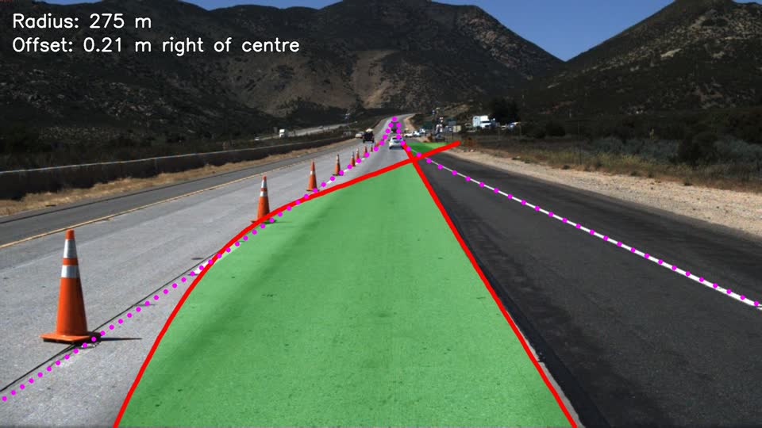
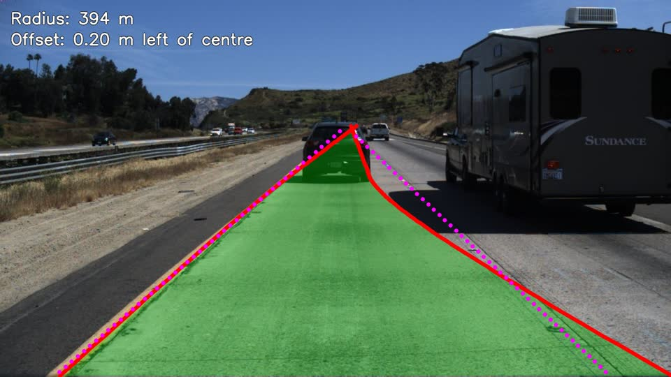
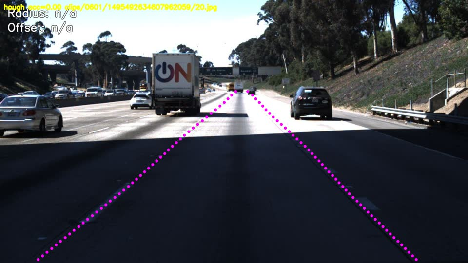

# Results

Every number on this page comes from `scripts/evaluate.py`. The JSON it wrote is in `results/`.

## Status

| Dataset | Status |
|---|---|
| Synthetic sanity check (50 clips) | Done. Numbers below. |
| TuSimple test set (2,782 clips) | Done, on Kaggle (no download). Numbers below. |

## Setup

- Metric: TuSimple-style, 20 px point threshold, 85% points for a lane match. Ego lanes only, pooled
  over all frames. Details in [design.md](design.md#evaluation-choices).
- Config: `configs/default.yaml`, unchanged.
- The smoothed variant runs on frames 1–20 of each clip and is scored on frame 20. The other variants
  see only frame 20.
- FPS: detector time only (no disk I/O or drawing). Single-threaded Python, 1280x720 frames, AMD Ryzen 5
  5600H, Python 3.12.3, OpenCV 5.0.0, NumPy 2.5.4.

## Synthetic sanity check

```bash
python scripts/evaluate.py --synthetic --clips 50 --save-worst 3 --output results/synthetic.json
```

50 clips × 20 frames, seed 0, 10 clips each of: straight, curve, shadow, worn paint, dropout (the
right line disappears in the last two frames, including the labelled one).

| Variant | Accuracy | FP | FN | FPS |
|---|---|---|---|---|
| Hough-line baseline | 98.2% | 0.056 | 0.056 | 406.0 |
| Sliding-window polynomial (main) | 100.0% | 0.000 | 0.000 | 55.3 |
| + temporal smoothing | 99.9% | 0.100 | 0.000 | 58.1 |
| CNN mask (optional) | not built | | | |

Accuracy, FP and FN are deterministic for a given seed and matched exactly across two runs. FPS varied
by about 5% between the same two runs (Hough 421 vs 406, sliding 53.0 vs 55.3, smoothed 55.0 vs 58.1).

### What the synthetic numbers do and don't show

- They show the pipeline is wired correctly: mask → warp → search → fit → unwarp lands within
  20 px of the exact ground truth on every labelled frame.
- They do **not** show the detector works on real roads. The synthetic roads are flat and clean, have
  no other vehicles, and use the same camera geometry the default config assumes. A perfect score is
  expected here.
- **Hough baseline:** it loses accuracy only on curves, because one straight line cannot follow the far
  end of a bend. Example (magenta dots = ground truth):

  

- **Smoothing FP = 0.100:** all of these come from the 10 dropout clips. When the right line vanishes,
  the tracker keeps drawing its last good estimate of it, but there is no ground-truth line there, so
  it counts as a false positive (10 of 100 predicted lanes). That is by design: for driving, holding
  the lane through a short dropout is usually the right call, but the metric penalises it.
  `tracker.max_failures` controls how long it holds on.
- **Smoothing accuracy 99.9%:** one labelled frame (`worn_018`, accuracy 0.95) is below 1.00. The
  per-frame variant scores 1.00 on the same frame, so the loss comes from tracking. The likely cause
  is the 5-frame average trailing a lane that is still moving. Every other frame scored 1.00:

  

- **Speed:** the Hough baseline is about 7× faster. The main pipeline's cost is mostly full-frame
  colour conversion, Sobel and warping at 1280x720. Searching around the previous fit saves very
  little by comparison, which is why the smoothed variant is only slightly faster than the per-frame one.

## TuSimple test set

Run as a private Kaggle notebook with the
[manideep1108/tusimple](https://www.kaggle.com/datasets/manideep1108/tusimple) dataset attached:

```bash
python scripts/kaggle_push.py          # runs kaggle/tusimple_eval.py on Kaggle
kaggle kernels output <user>/lanedet-tusimple-eval -p results/kaggle
```

All 2,782 labelled test frames, scored with the metric above (ego lanes, 20 px, 85%). The smoothed
variant processed 55,640 frames (each labelled frame plus the 19 before it).

| Variant | Accuracy | FP | FN | FPS |
|---|---|---|---|---|
| Hough-line baseline | 76.5% | 0.444 | 0.449 | 108.7 |
| Sliding-window polynomial (main) | 82.6% | 0.261 | 0.297 | 23.3 |
| + temporal smoothing | 82.8% | 0.255 | 0.296 | 24.3 |
| Sliding-window, untuned `default.yaml` | 35.6% | 0.999 | 1.000 | 28.5 |
| CNN mask (optional) | not built | | | |

Config: [configs/tusimple.yaml](../configs/tusimple.yaml). Raw output:
[results/tusimple.json](../results/tusimple.json).

**FPS is not comparable with the synthetic table.** It was measured on a shared Kaggle VM (Intel Xeon
@ 2.20 GHz, 4 vCPUs, Python 3.13.15, OpenCV 4.14.0, NumPy 2.1.3), single-threaded Python. It also
varies between Kaggle sessions: the same code measured 39.6 FPS (sliding) and 171.7 (Hough) in an
earlier session. Use the ratios (Hough is about 4-5x faster), not the absolute values.

### How the config was tuned (training data only)

The defaults were never fitted to TuSimple's camera: untuned, the main pipeline scores 35.6% and
matches almost no lane. `kaggle/tusimple_eval.py` fits the config to the **training** set:

1. **Perspective and ROI from labels.** For each of the 3,611 training frames with two ego lanes,
   fit a straight line to the near half of each ego lane. Use the median lines to place the
   trapezoid corners on the lane lines.
2. **Extend lanes upward.** `perspective.extend_to` = 0.334 x height, the 5th percentile of
   where training ego lanes are labelled to. Detected lanes are continued in a straight line up to
   that row. Without it, the predictions end at the trapezoid top and cannot cover 85% of a TuSimple
   lane.
3. **Grid search** on 400 random training frames (seed 0), per-frame pipeline: trapezoid top in
   {0.42, 0.45, 0.50, 0.55} x 3 threshold presets. Best: top 0.45, default thresholds, 73.2% on
   those training frames (full grid in `results/tusimple.json`).

**Test-set disclosure:** the test set was scored twice. The first run had no `extend_to` and gave
64.6% / 63.8% / 64.3% (Hough / sliding / smoothed), with FP and FN above 0.9. Its near-total
matching failure is what exposed the missing upward extension. That method change was made after
seeing test results. The parameter values above were still chosen on training frames only.

### What the TuSimple numbers show

- **The main pipeline beats the Hough baseline by 6.1 points** in accuracy, with 41% fewer FP and 34%
  fewer FN. Hough fits one straight line per side; the polynomial can bend with the lane.
- **Temporal smoothing adds only 0.2 points.** The tracker can bridge a short fade, but it cannot
  fix a fit that is wrong from the start of a clip, and long failures outlast its 5-frame history.
- **FN ≈ 0.30 means about 30% of ego lanes are missed or off by more than the tolerance.** For
  reference, published CNN methods report above 95% accuracy on TuSimple. That uses the standard
  all-lanes metric, so it is not directly comparable, but this classical pipeline is clearly far
  from state of the art. This baseline is what a CNN mask stage would be compared against.

### Failure cases (magenta dots = ground truth)

A typical success, straight road with clear paint (accuracy 1.00):



1. **Faint or sparse markings.** Worn dashes and raised pavement markers under overcast light
   don't pass the colour or gradient thresholds, so neither line is found (accuracy 0.00):

   

2. **Pavement texture and seams.** Grooved concrete next to asphalt produces many gradient edges. In
   this frame no fit passed the sanity checks (accuracy 0.00):

   

3. **Construction zones.** Cones and an asphalt seam are stronger edges than the paint, so the
   right line locks onto the seam (accuracy 0.20):

   

4. **Nearby vehicles and their shadows.** The right fit bends towards the RV's shadow edge
   (accuracy 0.61):

   

5. **Hard shadows (Hough).** An overpass shadow splits the road into bright and dark bands. Its
   edge is stronger than the paint, and the Hough baseline finds no lane (accuracy 0.00):

   

## Tests

`pytest --cov=lanedet`: 93 tests, 97% line coverage of `src/lanedet` (measured 2026-10-31).
